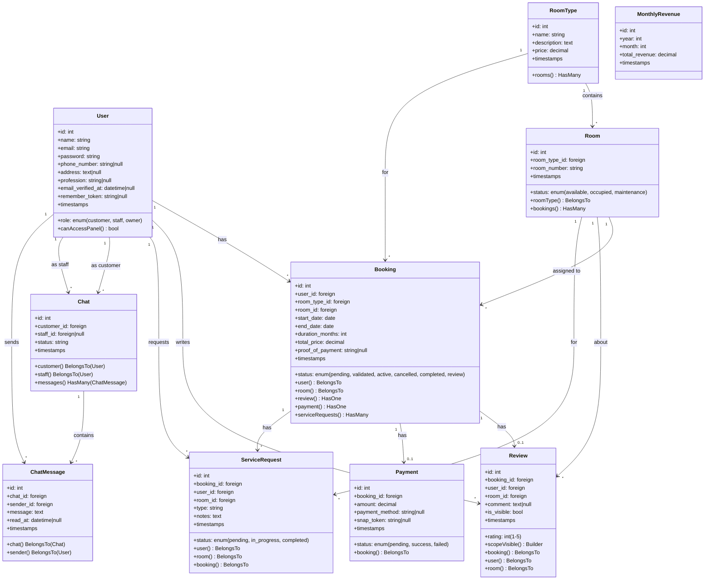

# Arcadia Kost — Class Diagram

## Model Classes

---

## Field Details Per Class

### User (`users` table)
| Field | Type | Constraints | Notes |
|---|---|---|---|
| id | bigint | PK, auto-increment | |
| name | string(255) | required | |
| email | string(255) | required, unique | |
| password | string(255) | required | Hashed via `Hash::make()` |
| role | string(255) | default: 'customer' | Values: customer, staff, owner |
| phone_number | string(255) | nullable | |
| address | text | nullable | |
| profession | string(255) | nullable | Used on review cards (e.g. "Mahasiswa Ilmu Komputer") |
| email_verified_at | timestamp | nullable | |
| remember_token | string(100) | nullable | |
| created_at | timestamp | auto | |
| updated_at | timestamp | auto | |

### RoomType (`room_types` table)
| Field | Type | Constraints | Notes |
|---|---|---|---|
| id | bigint | PK, auto-increment | |
| name | string(255) | required | e.g. "Standard Room" |
| description | text | nullable | Rich text with facility list |
| price | decimal(8,2) | required | Monthly price (e.g. 1750000) |
| created_at | timestamp | auto | |
| updated_at | timestamp | auto | |

### Room (`rooms` table)
| Field | Type | Constraints | Notes |
|---|---|---|---|
| id | bigint | PK, auto-increment | |
| room_type_id | bigint | FK → room_types.id | |
| room_number | string(255) | required | e.g. "Kamar 01" |
| status | string(255) | default: 'available' | Values: available, occupied, maintenance |
| created_at | timestamp | auto | |
| updated_at | timestamp | auto | |

### Booking (`bookings` table)
| Field | Type | Constraints | Notes |
|---|---|---|---|
| id | bigint | PK, auto-increment | |
| user_id | bigint | FK → users.id | |
| room_type_id | bigint | FK → room_types.id | |
| room_id | bigint | FK → rooms.id | |
| start_date | date | required | |
| end_date | date | required | start_date + duration_months |
| duration_months | int | default: 1 | |
| total_price | decimal(10,2) | required | room_type.price × duration |
| status | string(255) | default: 'pending' | Values: pending, validated, active, cancelled, completed, review |
| proof_of_payment | string(255) | nullable | Path to uploaded receipt image |
| created_at | timestamp | auto | |
| updated_at | timestamp | auto | |

### Payment (`payments` table)
| Field | Type | Constraints | Notes |
|---|---|---|---|
| id | bigint | PK, auto-increment | |
| booking_id | bigint | FK → bookings.id | |
| amount | decimal(10,2) | required | |
| payment_method | string(255) | nullable | e.g. "BCA Transfer" |
| status | string(255) | default: 'pending' | Values: pending, success, failed |
| snap_token | string(255) | nullable | Midtrans token (unused) |
| created_at | timestamp | auto | |
| updated_at | timestamp | auto | |

### Review (`reviews` table)
| Field | Type | Constraints | Notes |
|---|---|---|---|
| id | bigint | PK, auto-increment | |
| booking_id | bigint | FK → bookings.id | |
| user_id | bigint | FK → users.id | |
| room_id | bigint | FK → rooms.id | |
| rating | int | required, 1-5 | Star rating |
| comment | text | nullable | Max 500 chars in validation |
| is_visible | bool | default: false | Toggle for landing page display |
| created_at | timestamp | auto | |
| updated_at | timestamp | auto | |

### ServiceRequest (`service_requests` table)
| Field | Type | Constraints | Notes |
|---|---|---|---|
| id | bigint | PK, auto-increment | |
| booking_id | bigint | FK → bookings.id | |
| user_id | bigint | FK → users.id | |
| room_id | bigint | FK → rooms.id | |
| type | string(255) | required | e.g. "cleaning", "repair" |
| notes | text | nullable | Customer description |
| status | string(255) | default: 'pending' | Values: pending, in_progress, completed |
| created_at | timestamp | auto | |
| updated_at | timestamp | auto | |

### Chat (`chats` table)
| Field | Type | Constraints | Notes |
|---|---|---|---|
| id | bigint | PK, auto-increment | |
| customer_id | bigint | FK → users.id | |
| staff_id | bigint | FK → users.id, nullable | Assigned staff |
| status | string(255) | default: 'open' | |
| created_at | timestamp | auto | |
| updated_at | timestamp | auto | |

### ChatMessage (`chat_messages` table)
| Field | Type | Constraints | Notes |
|---|---|---|---|
| id | bigint | PK, auto-increment | |
| chat_id | bigint | FK → chats.id | |
| sender_id | bigint | FK → users.id | |
| message | text | required | |
| read_at | timestamp | nullable | Read receipt |
| created_at | timestamp | auto | |
| updated_at | timestamp | auto | |

### MonthlyRevenue (`monthly_revenues` table)
| Field | Type | Constraints | Notes |
|---|---|---|---|
| id | bigint | PK, auto-increment | |
| year | int | required | |
| month | int | required | 1-12 |
| total_revenue | decimal(15,2) | default: 0 | |
| created_at | timestamp | auto | |
| updated_at | timestamp | auto | |

---

## Relationship Summary

| From | To | Type | Foreign Key |
|---|---|---|---|
| User | Booking | 1 → * | booking.user_id |
| User | Review | 1 → * | review.user_id |
| User | ServiceRequest | 1 → * | service_request.user_id |
| User (customer) | Chat | 1 → * | chat.customer_id |
| User (staff) | Chat | 1 → * | chat.staff_id |
| User | ChatMessage | 1 → * | chat_message.sender_id |
| RoomType | Room | 1 → * | room.room_type_id |
| RoomType | Booking | 1 → * | booking.room_type_id |
| Room | Booking | 1 → * | booking.room_id |
| Room | Review | 1 → * | review.room_id |
| Room | ServiceRequest | 1 → * | service_request.room_id |
| Booking | Review | 1 → 0..1 | review.booking_id |
| Booking | Payment | 1 → 0..1 | payment.booking_id |
| Booking | ServiceRequest | 1 → * | service_request.booking_id |
| Chat | ChatMessage | 1 → * | chat_message.chat_id |