# Arcadia Kost — Use Case Specification

## Actors

| Actor | Description |
|---|---|
| **Guest** | Unauthenticated visitor browsing the public site |
| **Customer** | Registered, logged-in resident of the kost |
| **Staff** | Admin staff with limited panel access (manage rooms, reviews, service requests) |
| **Owner** | Full admin access — manages bookings, users, payments, and all system configuration |
| **System** | Automated processes (room assignment, revenue calculation, notification) |

---

## Use Case Diagram

```mermaid
graph TB
    subgraph "Arcadia Kost System"
        direction TB

        %% ── Public ──
        subgraph Public
            UC1["View Landing Page"]
            UC2["Browse Rooms & Facilities"]
            UC3["Read Reviews"]
            UC4["Register Account"]
        end

        %% ── Customer ──
        subgraph Customer
            UC5["Login / Logout"]
            UC6["Manage Profile"]
            UC7["View Dashboard"]
            UC8["Create Booking"]
            UC9["View My Bookings"]
            UC10["Make Payment<br>(Upload Proof)"]
            UC11["Extend Booking"]
            UC12["Submit Review"]
            UC13["Request Service<br>(Cleaning/Repair)"]
            UC14["Chat with Staff"]
        end

        %% ── Staff ──
        subgraph StaffRole
            UC15["Login to Admin Panel"]
            UC16["Manage Room Types"]
            UC17["Manage Rooms"]
            UC18["View & Validate Bookings"]
            UC19["Validate Payment Proofs"]
            UC20["Manage Reviews<br>(Toggle Visibility)"]
            UC21["Manage Service Requests"]
            UC22["Chat with Customers"]
            UC23["View Dashboard Stats"]
        end

        %% ── Owner ──
        subgraph OwnerRole
            UC24["Manage Users & Roles"]
            UC25["Full Booking Management<br>(Edit/Delete/Cancel)"]
            UC26["View Revenue Reports"]
            UC27["Full Payment Management"]
        end

        %% ── System ──
        subgraph SystemActor
            UC28["Calculate Monthly Revenue"]
            UC29["Auto-Assign Room on Booking"]
            UC30["Free Room on Deletion"]
        end
    end

    %% ── Guest ──
    Guest --> UC1
    Guest --> UC2
    Guest --> UC3
    Guest --> UC4

    %% ── Customer ──
    Customer --> UC5
    Customer --> UC6
    Customer --> UC7
    Customer --> UC8
    Customer --> UC9
    Customer --> UC10
    Customer --> UC11
    Customer --> UC12
    Customer --> UC13
    Customer --> UC14

    %% ── Staff ──
    Staff --> UC15
    Staff --> UC16
    Staff --> UC17
    Staff --> UC18
    Staff --> UC19
    Staff --> UC20
    Staff --> UC21
    Staff --> UC22
    Staff --> UC23

    %% ── Owner ──
    Owner --> UC15
    Owner --> UC16
    Owner --> UC17
    Owner --> UC18
    Owner --> UC19
    Owner --> UC20
    Owner --> UC21
    Owner --> UC22
    Owner --> UC23
    Owner --> UC24
    Owner --> UC25
    Owner --> UC26
    Owner --> UC27

    %% ── System ──
    System --> UC28
    System --> UC29
    System --> UC30

    %% ── Include / Extend ──
    UC8 -.-> UC29
    UC30 -.-> UC25
    UC10 -.-> UC19
```

---

## Use Case Details

### 1. Guest Use Cases

#### UC-01: View Landing Page
| Field | Value |
|---|---|
| **Actor** | Guest |
| **Description** | Guest accesses the public homepage to learn about the kost |
| **Precondition** | None |
| **Postcondition** | Landing page is displayed with hero, facilities, room info, location, and visible reviews |
| **Trigger** | Guest navigates to `/` |
| **Flow** | 1. System loads landing page 2. System fetches visible reviews from database 3. System renders hero section, facility grid, room details, location info, and review carousel |

#### UC-02: Browse Rooms & Facilities
| Field | Value |
|---|---|
| **Actor** | Guest |
| **Description** | Guest views room types, pricing, and facilities |
| **Trigger** | Guest scrolls to facility/room sections on landing page |
| **Flow** | 1. System displays curated facilities (WiFi, cleaning, pantry, security) 2. System shows Standard Room details with pricing (Rp 1.500.000/month) |

#### UC-03: Read Reviews
| Field | Value |
|---|---|
| **Actor** | Guest |
| **Description** | Guest reads testimonials from existing residents |
| **Trigger** | Guest scrolls to Resident Stories section |
| **Flow** | 1. System loads reviews where `is_visible = true` 2. System displays star rating, comment, resident name, and profession 3. Guest can navigate through carousel |

#### UC-04: Register Account
| Field | Value |
|---|---|
| **Actor** | Guest |
| **Description** | Guest creates a new customer account |
| **Precondition** | Email not already registered |
| **Postcondition** | New user account created; verification email sent |
| **Trigger** | Guest clicks Register and submits the form |
| **Flow** | 1. Guest fills name, email, password, password confirmation 2. System validates input (unique email, password match) 3. System creates user with role `customer` 4. System sends email verification link 5. System redirects to login with success message |

---

### 2. Customer Use Cases

#### UC-05: Login / Logout
| Field | Value |
|---|---|
| **Actor** | Customer |
| **Description** | Customer authenticates into the system |
| **Precondition** | Account exists and email is verified |
| **Postcondition** | User is authenticated and redirected to dashboard |
| **Alternate** | Invalid credentials → rate-limited error message |

#### UC-06: Manage Profile
| Field | Value |
|---|---|
| **Actor** | Customer |
| **Description** | Customer updates personal information |
| **Trigger** | Customer navigates to profile page |
| **Flow** | 1. System displays current profile data (name, email, phone, address) 2. Customer edits fields and submits 3. System validates and updates record |

#### UC-07: View Dashboard
| Field | Value |
|---|---|
| **Actor** | Customer |
| **Description** | Customer sees room types, available rooms count, and average rating |
| **Trigger** | Customer logs in or navigates to `/dashboard` |
| **Flow** | 1. System loads all room types with their rooms 2. System calculates stats (available rooms, average rating, total reviews) 3. System renders dashboard cards |

#### UC-08: Create Booking
| Field | Value |
|---|---|
| **Actor** | Customer |
| **Description** | Customer books a room of a selected room type |
| **Precondition** | Customer is authenticated and email-verified |
| **Postcondition** | Booking created with status `pending`; assigned room marked `occupied` |
| **Trigger** | Customer selects a room type and submits booking form |
| **Flow** | 1. Customer selects room type 2. System auto-assigns first available room of that type 3. System calculates total price (room price × duration) 4. System creates booking record 5. System sets room status to `occupied` 6. System redirects to payment page |
| **Includes** | UC-29 (Auto-Assign Room) |

#### UC-09: View My Bookings
| Field | Value |
|---|---|
| **Actor** | Customer |
| **Description** | Customer views all their bookings with status and actions |
| **Trigger** | Customer navigates to `/my-bookings` |
| **Flow** | 1. System loads customer's bookings with room details 2. For each booking, system shows relevant action buttons (pay, extend, review, request service) based on status |

#### UC-10: Make Payment
| Field | Value |
|---|---|
| **Actor** | Customer |
| **Description** | Customer views payment instructions and uploads transfer receipt |
| **Precondition** | Booking exists with status `pending` |
| **Postcondition** | Booking status changes to `review`; proof uploaded |
| **Flow** | 1. System displays BCA bank details and total amount 2. System generates and shows QR code 3. Customer transfers money manually 4. Customer uploads proof of payment (receipt image) 5. System stores proof and updates booking status to `review` |

#### UC-11: Extend Booking
| Field | Value |
|---|---|
| **Actor** | Customer |
| **Description** | Customer extends their stay by creating a new consecutive booking |
| **Precondition** | Active booking exists |
| **Postcondition** | New booking created starting from next month |
| **Flow** | 1. System copies room and pricing from current booking 2. System sets start_date to current booking's end_date 3. System creates new booking in `pending` status 4. Customer proceeds to payment |

#### UC-12: Submit Review
| Field | Value |
|---|---|
| **Actor** | Customer |
| **Description** | Customer rates their room and leaves a comment |
| **Precondition** | Booking must be `active`; no existing review for this booking |
| **Postcondition** | Review created with `is_visible = false` (awaiting admin approval) |
| **Flow** | 1. Customer selects rating (1-5 stars) 2. Customer writes optional comment (max 500 chars) 3. System validates and creates review 4. System redirects to my-bookings with success message |

#### UC-13: Request Service
| Field | Value |
|---|---|
| **Actor** | Customer |
| **Description** | Customer requests cleaning or repair service |
| **Precondition** | Booking must be `active` |
| **Postcondition** | Service request created with status `pending` |
| **Flow** | 1. Customer selects service type (cleaning/repair) 2. Customer writes notes/description 3. System creates service request 4. Staff is notified via admin panel |

#### UC-14: Chat with Staff
| Field | Value |
|---|---|
| **Actor** | Customer |
| **Description** | Customer sends and receives messages with staff/owner |
| **Precondition** | Customer is authenticated |
| **Flow** | 1. System loads or creates active chat session 2. Customer types a message and sends 3. System stores message with sender 4. System polls for new messages every 3 seconds 5. New messages appear in real-time-like fashion |

---

### 3. Staff Use Cases

#### UC-15: Login to Admin Panel
| Field | Value |
|---|---|
| **Actor** | Staff, Owner |
| **Description** | Staff/owner authenticates into Filament admin panel at `/admin` |
| **Precondition** | User has role `staff` or `owner` |
| **Postcondition** | User is redirected to admin dashboard |

#### UC-16: Manage Room Types
| Field | Value |
|---|---|
| **Actor** | Staff, Owner |
| **Description** | CRUD operations on room type definitions (name, description, price) |

#### UC-17: Manage Rooms
| Field | Value |
|---|---|
| **Actor** | Staff, Owner |
| **Description** | CRUD operations on individual rooms (room number, status) |

#### UC-18: View & Validate Bookings
| Field | Value |
|---|---|
| **Actor** | Staff, Owner |
| **Description** | Staff reviews booking details and confirms payment or cancels booking |
| **Trigger** | Customer uploads proof of payment → booking status is `review` |
| **Flow** | 1. Staff opens booking detail 2. Staff views uploaded proof of payment 3. Staff confirms payment → booking becomes `active` 4. OR staff cancels → room freed, booking cancelled |

#### UC-19: Validate Payment Proofs
| Field | Value |
|---|---|
| **Actor** | Staff, Owner |
| **Description** | Staff verifies uploaded transfer receipts and approves/rejects |
| **Flow** | 1. Staff views receipt image 2. Staff confirms → payment confirmed, booking activated 3. Staff rejects → booking cancelled |

#### UC-20: Manage Reviews
| Field | Value |
|---|---|
| **Actor** | Staff, Owner |
| **Description** | Staff toggles `is_visible` flag to control which reviews appear on landing page |
| **Flow** | 1. Staff views list of reviews 2. Staff toggles "Tampil" column on/off 3. Only visible reviews appear on public landing page |

#### UC-21: Manage Service Requests
| Field | Value |
|---|---|
| **Actor** | Staff, Owner |
| **Description** | Staff views and updates status of cleaning/repair requests |

#### UC-22: Chat with Customers
| Field | Value |
|---|---|
| **Actor** | Staff, Owner |
| **Description** | Staff responds to customer messages through the Filament chat interface |
| **Flow** | 1. System lists all active chats in sidebar 2. Staff selects a chat 3. System loads message history 4. Staff types and sends response 5. System polls every 3 seconds for new messages |

#### UC-23: View Dashboard Stats
| Field | Value |
|---|---|
| **Actor** | Staff, Owner |
| **Description** | Staff views admin dashboard with statistics widgets |
| **Flow** | 1. System shows StatsOverview (total bookings, available rooms, today's bookings, total revenue) 2. System shows RevenueChart (line chart from monthly_revenues) 3. System shows RecentBookings table 4. System shows ReviewStats |

---

### 4. Owner-Only Use Cases

#### UC-24: Manage Users & Roles
| Field | Value |
|---|---|
| **Actor** | Owner |
| **Description** | Owner creates, edits, or deletes users and assigns roles (customer/staff/owner) |
| **Policy** | Only `owner` role can access Users resource |

#### UC-25: Full Booking Management
| Field | Value |
|---|---|
| **Actor** | Owner |
| **Description** | Owner can edit or delete any booking in the system (not just view) |
| **Policy** | Only `owner` role has edit/delete permissions on bookings |

#### UC-26: View Revenue Reports
| Field | Value |
|---|---|
| **Actor** | Owner |
| **Description** | Owner views revenue trends over time |
| **Flow** | 1. System aggregates monthly revenue data 2. System renders line chart on dashboard 3. Data populated by artisan command `app:calculate-monthly-revenue` |

#### UC-27: Full Payment Management
| Field | Value |
|---|---|
| **Actor** | Owner |
| **Description** | Owner views and manages all payment records |

---

### 5. System Use Cases

#### UC-28: Calculate Monthly Revenue
| Field | Value |
|---|---|
| **Actor** | System |
| **Description** | Automated command sums booking revenue per month |
| **Trigger** | `php artisan app:calculate-monthly-revenue` (manual or scheduled) |
| **Flow** | 1. System queries completed/active bookings for current and previous month 2. System sums total_price per month 3. System upserts into `monthly_revenues` table |

#### UC-29: Auto-Assign Room
| Field | Value |
|---|---|
| **Actor** | System |
| **Description** | On booking creation, system assigns first available room of the requested type |
| **Flow** | 1. System queries rooms of the selected type where status = `available` 2. System picks the first available room (ordered by ID) 3. System sets room status to `occupied` 4. System links booking to the assigned room |
| **Included By** | UC-08 (Create Booking) |

#### UC-30: Free Room on Deletion
| Field | Value |
|---|---|
| **Actor** | System |
| **Description** | When a booking is deleted, the associated room is freed |
| **Trigger** | Booking model `deleted` event |
| **Flow** | 1. System detects booking deletion via model boot event 2. System sets associated room's status to `available` |

---

## Business Rules Summary

| Rule | Description |
|---|---|
| **One-Month Duration** | All bookings are exactly 1 month. Extensions create new consecutive bookings. |
| **Auto-Assignment** | First available room of the requested type is automatically assigned. |
| **Room Lifecycle** | available → occupied (on booking) → available (on booking delete/cancel) |
| **Booking Status Flow** | pending → review (proof uploaded) → active (admin confirms) / cancelled → completed |
| **One Review Per Booking** | Duplicate prevention enforced in ReviewController. |
| **Public Reviews** | Only `is_visible = true` reviews appear on the landing page. |
| **Active-Only Actions** | Only `active` bookings can submit reviews or service requests. |
| **Role Gating** | Only `owner` can manage users and edit/delete bookings. `staff` and `owner` can access `/admin`. |
| **Email Verification** | Customers must verify email before accessing dashboard/booking features. |

---

## File Reference

| Use Case | Controller / File | Route |
|---|---|---|
| UC-01 | `LandingPageController` | `GET /` |
| UC-04 | `RegisteredUserController` | `GET/POST /register` |
| UC-05 | `AuthenticatedSessionController` | `GET/POST /login`, `POST /logout` |
| UC-06 | `ProfileController` | `GET/PATCH /profile` |
| UC-07 | Route closure | `GET /dashboard` |
| UC-08 | `BookingController@create/store` | `GET/POST /booking/{roomType}` |
| UC-09 | `BookingController@myBookings` | `GET /my-bookings` |
| UC-10 | `BookingController@pay/uploadProof` | `GET /booking/{booking}/pay`, `POST /booking/{booking}/upload-proof` |
| UC-11 | `BookingController@extend` | `POST /booking/{booking}/extend` |
| UC-12 | `ReviewController@create/store` | `GET/POST /booking/{booking}/review` |
| UC-13 | `ServiceRequestController@create/store` | `GET/POST /booking/{booking}/service-request` |
| UC-14 | `ChatController` | `GET /chat/active`, `POST /chat/{id}/message` |
| UC-15 | Filament auth | `/admin/login` |
| UC-16-27 | Various Filament Resources | `/admin/{resource}` |
| UC-22 | `StaffChat` Filament Page | `/admin/staff-chat` |
| UC-28 | `app:calculate-monthly-revenue` | Artisan command |